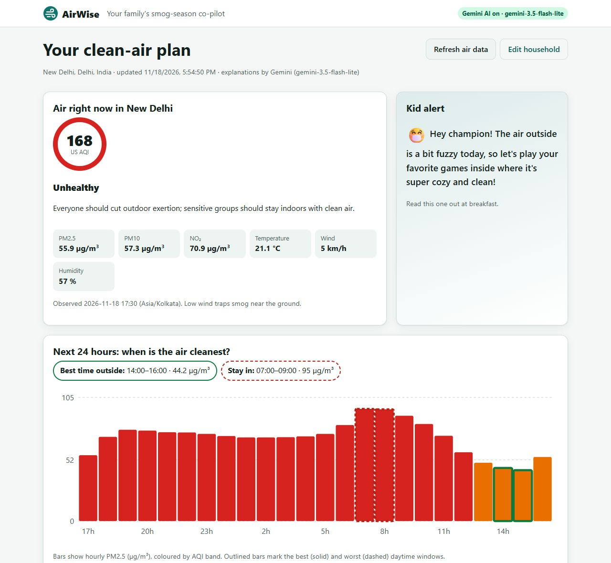
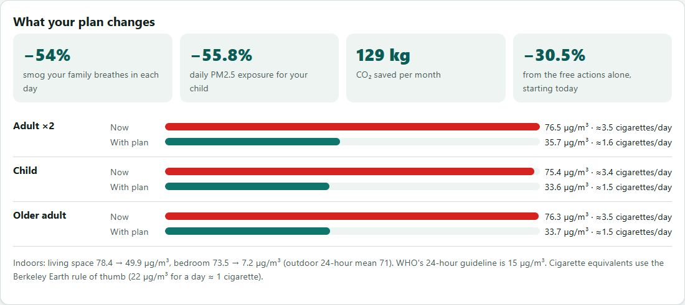
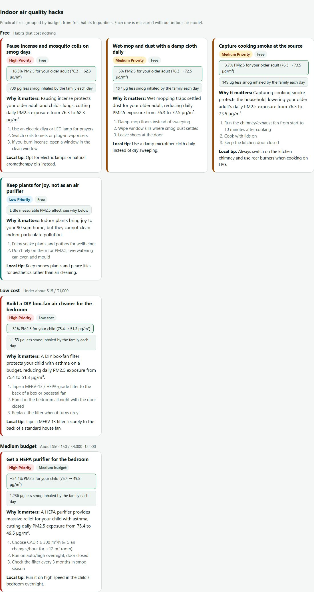
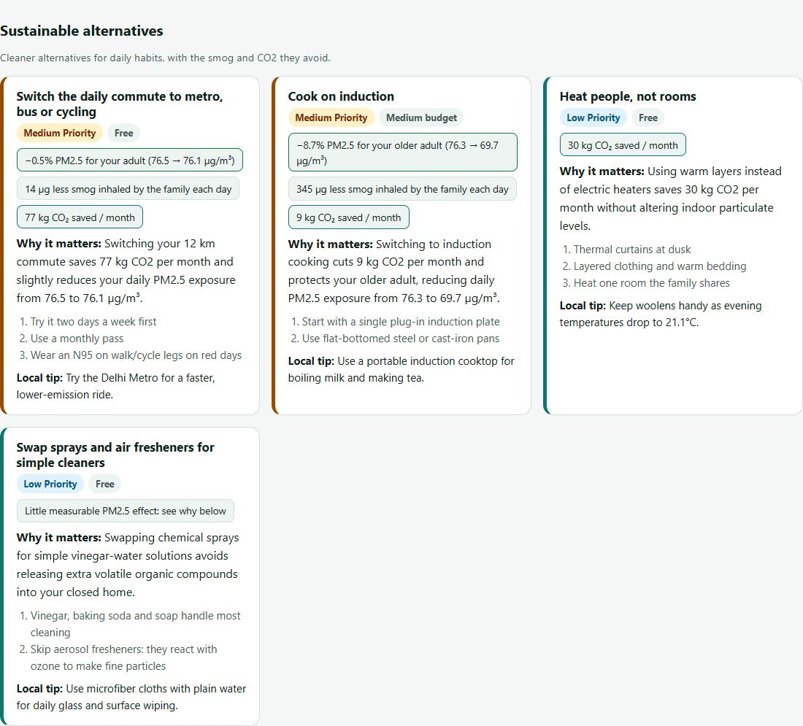
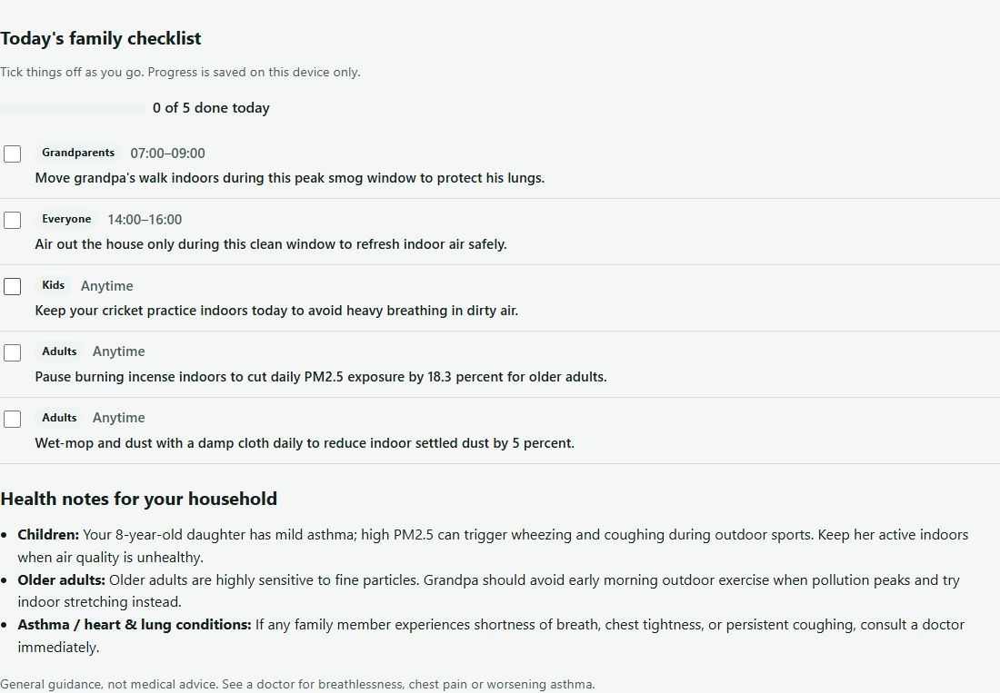
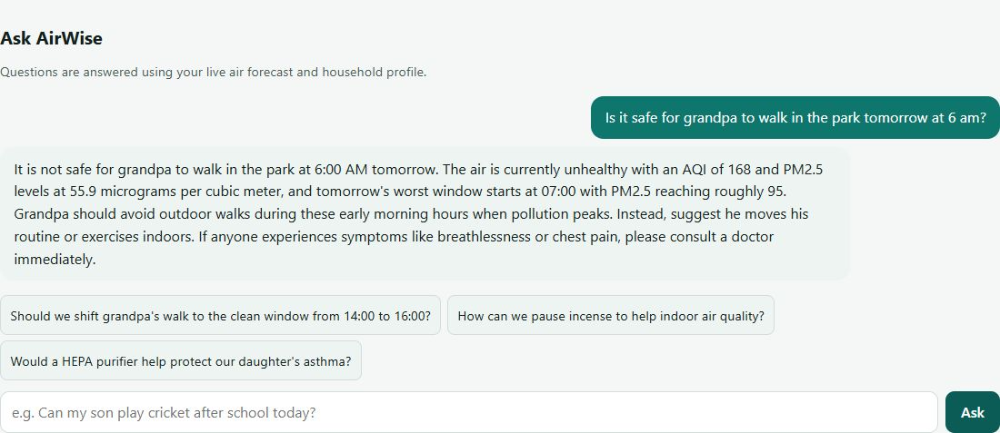
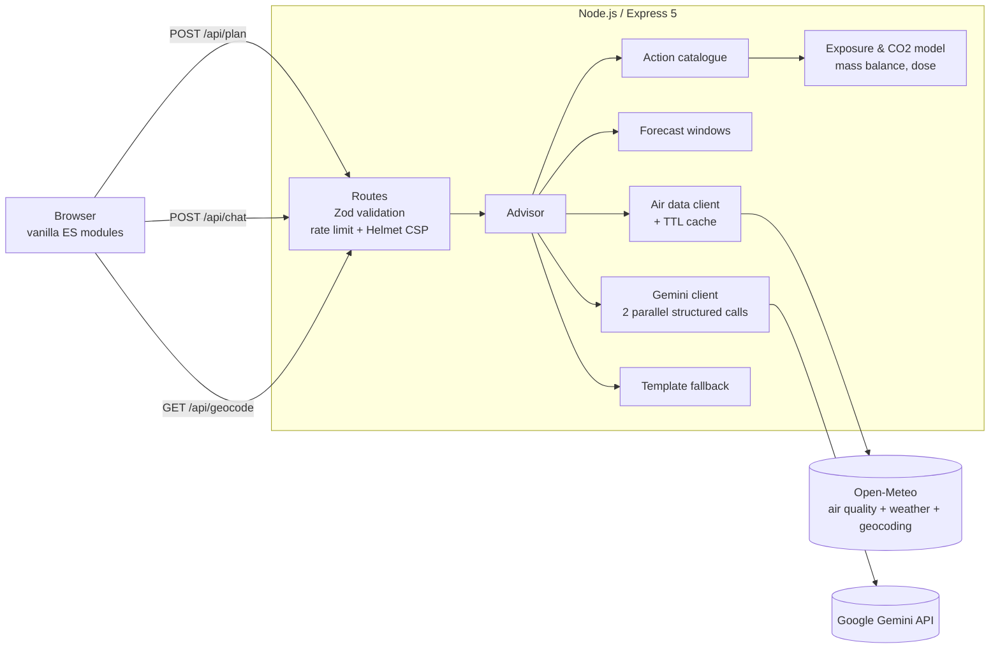

# 🌫️ AirWise: Family Clean-Air Assistant

A Generative-AI assistant that helps **families and communities get through severe winter smog**. You tell it where you
live and how your household runs. AirWise then reads the **live air-quality forecast**, finds the **cleanest hours**
to go outside, and ranks **low-emission routines, budget-tiered indoor air hacks and cleaner swaps** by how much they
cut your family's exposure. Every recommendation comes with a **quantified impact** (PM2.5 exposure, inhaled dose,
cigarette equivalents, CO2) that **Google Gemini explains in plain language**.

Built for PromptWars Challenge 6: Urban Air Quality Assistant.

[](../../actions/workflows/ci.yml)
· 73 tests · 99.6% line / 94% branch coverage · 0 TypeScript errors · 0 axe-core WCAG 2.2 AA violations · 0 npm audit vulnerabilities

| Challenge requirement                        | How AirWise delivers it                                                                                                                                                                                                                                                                                                                                                                              |
| -------------------------------------------- | ---------------------------------------------------------------------------------------------------------------------------------------------------------------------------------------------------------------------------------------------------------------------------------------------------------------------------------------------------------------------------------------------------- |
| **Context-aware hyper-personalisation**      | City search or "use my location" pulls **live AQI, PM2.5, PM10, NO2, wind, temperature and a 24-hour hourly forecast** (Open-Meteo / CAMS). The household profile covers adults, children, older adults, asthma/heart conditions, pregnancy, commute mode and distance, home size, ventilation, cooking fuel, heating, purifiers, incense, smoking, exercise habits, budget and free-text notes.     |
| **Low-emission daily routines**              | The cleanest and worst **2-hour daytime windows** come from the hourly forecast, so you know when to move workouts, errands, outdoor play and window-airing. Also covers carpooling, switching off when idling, and cutting standby power.                                                                                                                                                           |
| **Indoor air quality hacks (budget-tiered)** | Grouped **Free → Low cost → Medium → Investment**: wet mopping, pausing incense, capturing kitchen smoke, sealing drafts, a DIY box-fan + MERV-13 cleaner, a sized HEPA purifier, smart purifier scheduling and filtered fresh air. It also busts the "plants clean the air" myth.                                                                                                                   |
| **Sustainable alternatives**                 | Metro, bus or cycling vs. car; EV; induction vs. gas or biomass; wood or kerosene → LPG; angithi → electric heating; "heat people, not rooms"; swapping aerosol sprays for simple cleaners.                                                                                                                                                                                                          |
| **Quantified impact explanations**           | A physics-based exposure model computes every number: _"−34% PM2.5 for your child (75 → 50 µg/m³)", "1,236 µg less smog inhaled by the family each day", "77 kg CO2 saved / month"_. A whole-plan summary shows each member's exposure before and after, with cigarette equivalents, plus a "free actions only" scenario. Gemini explains _why_ each one matters for this family.                    |
| **Community & family focus**                 | A **family checklist** for today (tickable, saved on the device) assigned to Everyone, Kids, Grandparents or the Commuter at real forecast times. A **kid-friendly alert** to read out at breakfast. **Neighbourhood ideas** (carpool boards, filter bulk-buys, no-idling school gates, reporting garbage burning) and a **one-click air alert message** to paste into the building or school group. |
| **Conversational follow-ups**                | **Ask AirWise** answers questions such as _"Is it safe for grandpa to walk at 6 am tomorrow?"_ using the live forecast and your profile, and suggests follow-up questions.                                                                                                                                                                                                                           |

## Screenshots

These show real output for the demo family in New Delhi (live CAMS data, Gemini `gemini-3.5-flash-lite`).

| Live air & 24-hour forecast                                                                                                | Plan impact                                                                                               |
| -------------------------------------------------------------------------------------------------------------------------- | --------------------------------------------------------------------------------------------------------- |
|  |  |
| **Indoor hacks by budget**                                                                                                 | **Cleaner swaps**                                                                                         |
|                 |        |
| **Family checklist**                                                                                                       | **Ask AirWise**                                                                                           |
|           |                           |

---

## Architecture



**The key design decision: the model calculates, the AI explains.** LLMs are good at empathy and local context but
unreliable with numbers. So:

1. **Live data**: [`airData.js`](src/services/airData.js) fetches current readings and a 24-hour hourly forecast,
   cached per ~1 km grid cell for 10 minutes. [`windows.js`](src/services/windows.js) finds the cleanest and worst
   daytime windows.
2. **Exposure model**: [`exposure.js`](src/services/exposure.js) applies a standard indoor mass balance
   `C_in = (P·a·C_out + G) / (a + k + CADR/V)` and a closed-bedroom zone. It then weights time spent in the bedroom,
   the rest of the home, outdoors and on the commute, using breathing rates for each age group.
   See **[docs/methodology.md](docs/methodology.md)** for every constant and its source.
3. **Actions as model changes**: each item in [`actions.js`](src/services/actions.js) is a set of `mods` (for
   example `{ bedroomCadr: 300 }` or `{ cookingFuel: 'induction' }`). The model runs before and after, so impact is
   a real difference. Actions are filtered by applicability and budget. Anything that would _raise_ exposure (such as
   sealing drafts in a home that burns incense) is dropped.
4. **Gemini personalises**: two **parallel** calls with **structured output** (`responseJsonSchema`, with action ids
   as a per-request enum) return priorities and "why it matters" text for each action, plus the headline, kid alert,
   checklist, community ideas and health notes. Splitting the work keeps a full plan to about 5 s. Output is
   re-validated with Zod: unknown ids are dropped, over-long text is truncated, and unknown enums fall back.
5. **Whole-plan impact** merges all mods (strongest purifier, cleanest fuel, and so on) and runs the model once
   more, so overlapping actions are never double-counted.
6. **Graceful degradation**: with no key, a timeout or bad output, each part falls back to template text built from
   the same numbers. Upstream air-data outages return a friendly 502, never a stack trace.

### Project structure

```
server.js                    Entry point (config → air client → Gemini → advisor → app)
src/
  app.js                     Express app: Helmet CSP, rate limits, JSON-only API, request ids, error handler
  config.js                  Env parsing with safe defaults
  constants.js               Emission factors, ventilation, sources, breathing rates
  validation.js              Zod schemas for profile, chat, query strings
  routes/api.js              /health, /geocode, /air, /plan, /chat
  services/
    airData.js               Open-Meteo client + normalisation
    aqi.js                   EPA PM2.5 → AQI, bands, kid messages
    windows.js               Cleanest / worst daytime windows
    exposure.js              Indoor mass balance, personal exposure, dose, CO2
    actions.js               Action catalogue, evaluation, mod merging
    advisor.js               Orchestration, AI merge, impact summary, cache
    prompts.js               System prompts + tagged, injection-safe prompt builders
    geminiSchemas.js         Response JSON schemas + lenient Zod parsers
    gemini.js                Gemini client (timeout, retry on 429/503)
    fallback.js              Template wording when AI is unavailable
public/
  index.html, css/styles.css
  js/main.js                 Controller (state, events, persistence)
  js/render.js, panels/*     Air card, forecast chart, impact, pillars, family, community, chat
  js/form.js, tabs.js, dom.js, api.js, storage.js, labels.js
tests/                       node:test suites (model, advisor, API, UI + axe, Gemini, support)
docs/methodology.md          Model equations, constants and sources
```

## Running locally

Requires Node 22 or later.

```bash
npm install
cp .env.example .env        # add GEMINI_API_KEY (free at https://aistudio.google.com/apikey)
npm start                   # http://localhost:8080
```

Without a key, AirWise still works fully in template mode: live data, every number and every action stay the same;
only the wording is generic.

| Variable                              | Default                 | Purpose                                 |
| ------------------------------------- | ----------------------- | --------------------------------------- |
| `GEMINI_API_KEY`                      | –                       | Enables Gemini explanations and chat    |
| `GEMINI_MODEL`                        | `gemini-3.5-flash-lite` | Any Gemini model with structured output |
| `AI_TIMEOUT_MS` / `AI_THINKING_LEVEL` | `30000` / `LOW`         | Latency controls                        |
| `AIR_TIMEOUT_MS`                      | `8000`                  | Open-Meteo timeout                      |
| `RATE_LIMIT_PER_MINUTE`               | `20`                    | Per-IP limit on data and AI endpoints   |
| `CACHE_TTL_MS`                        | `600000`                | Air-data and plan cache                 |

## Quality

```bash
npm run check   # lint + format + typecheck + tests with coverage gates + npm audit
```

- **Testing**: 73 tests across the exposure physics, AQI breakpoints, forecast windows, action rules, advisor (AI
  merge, partial and total AI failure, cache, prompt-injection framing), the full HTTP stack (validation, 413, 415,
  429, 502, 500 hygiene, security headers), the Gemini client (retries, timeouts) and the UI in jsdom (rendering,
  XSS, form round-trip, keyboard tabs). Coverage gates are 90% lines and 80% branches; current figures are 99.6% and
  94%.
- **Accessibility**: axe-core audits the form and every rendered panel against WCAG 2.2 AA in the test suite. The
  page has a skip link, labelled fields, the WAI-ARIA tabs pattern with arrow, Home and End keys, live regions for
  chat and status, an error summary that links to each field, a chart with a text alternative plus a data table,
  44 px touch targets, visible focus, dark mode, reduced-motion support and a print stylesheet.
- **Security**: see [SECURITY.md](SECURITY.md). It covers the strict CSP, the server-only key, text-node rendering,
  tagged untrusted input, schema-constrained AI output, rate limits, and no stored personal data.
- **Efficiency**: two parallel AI calls (about 5 s per plan), cached air data and plans, compression, a dependency-
  free frontend (no framework, no build step) and small payloads.

## Deploy

- **Render**: New + → Blueprint → select this repo ([`render.yaml`](render.yaml)), then set `GEMINI_API_KEY`.
- **Docker / Cloud Run**: `docker build -t airwise . && docker run -p 8080:8080 -e GEMINI_API_KEY=… airwise`

## Limitations

The impact figures come from a model for **comparing options**, not a measurement of your home. CAMS data is about
11 km resolution, so busy streets can be worse. AirWise is not medical advice.

## License

MIT
